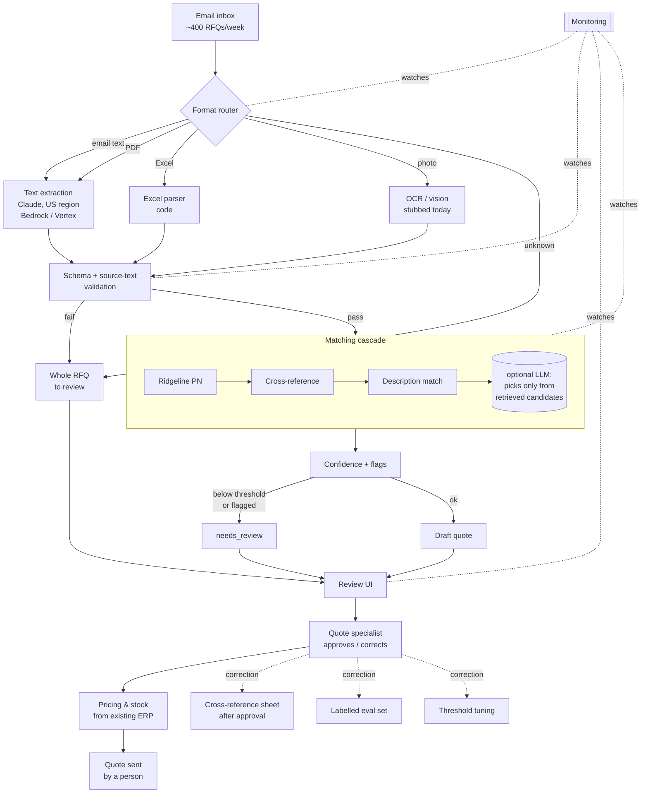

# Production Design — Ridgeline Quote Desk

## Handling failures & new formats
- Nothing is ever dropped: on extraction failure or an unknown format, the **whole RFQ goes to review** with a reason attached.
- Alert if the **review rate for any one format** suddenly jumps (signals a new layout or a broken parser).
- RPA lesson: don't hard-automate brittle format assumptions — route the uncertain cases to a human instead of guessing.

## What to monitor / alert triggers
- **Review rate** (overall and per format) — alert on spikes.
- **Correction rate per match method** (Ridgeline PN / cross-ref / description / LLM) — alert if one method degrades.
- **Validation failures** and **unknown customers** — alert on rising trend.
- **Latency** and **cost per RFQ** — alert on threshold breach.

## Rough cost & latency per RFQ (estimate)
Measured from one real extraction call (rfq_01_email.txt, `claude-haiku-4-5`, Haiku 4.5 pricing $1.00/$5.00 per 1M tokens in/out):

- Tokens: **1,668 in + 294 out** per RFQ (`response.usage`).
- Cost per RFQ: `1,668 × $1.00/1M + 294 × $5.00/1M` = `$0.001668 + $0.001470` = **~$0.0031**.
- At 400 RFQs/week: `667,200 in × $1.00/1M + 117,600 out × $5.00/1M` = `$0.667 + $0.588` = **~$1.26/week** (~$5/month).
- Latency: **~3.75 s** per RFQ (single extraction call, wall-clock).

Estimate caveats: figures are for the LLM text/PDF path. Excel RFQs are parsed in code (no LLM → ~$0), photos are stubbed today. Matching adds negligible cost (no LLM in the current cascade).

## How reviewer corrections improve the system
- Approved item pairs feed the **cross-reference sheet**, so the next identical RFQ matches in code.
- Every correction grows the **labelled eval set** used to measure accuracy.
- Measured errors drive **per-method threshold tuning** (tighten/loosen each stage independently).

## With two more weeks
- Real **OCR/vision** for photo RFQs (replace the stub).
- **LLM fallback** wired in, strictly limited to retrieved candidates.
- A proper **review UI** for specialists.
- **ERP price/stock lookup** integrated into the draft.
- Use **customer order history** as an extra matching hint.
