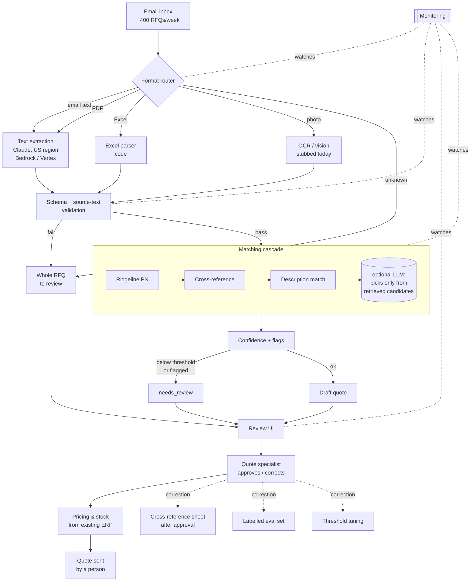

# Ridgeline Quote Desk

## Repository

## How to Run
1. Copy `.env.example` to `.env` and add your `ANTHROPIC_API_KEY`.
2. Install dependencies: `pip install -r requirements.txt`
3. Run the pipeline (writes `outputs/`): `python run_pipeline.py`
4. Run the evaluation (writes `evaluation/results.json`): `python evaluate.py`

## Approach
- **Routing by file type.** Excel is parsed in code (header row auto-detected by searching for `Qty`; `Item #` + `Desc.` become `as_written`). Email and PDF text go to **Claude Haiku** with a **strict JSON schema** (forced tool-use, temperature 0). The handwritten photo is **stubbed** for OCR / a vision model.
- **The model only reads, it never invents.** It extracts `as_written`, quantity and unit — never part numbers, never quantities it can't see, never prices. Any prices in the RFQ are ignored.
- **Source-text validation.** Every LLM-extracted `as_written` must appear verbatim in the source (whitespace/case-normalised). If it doesn't, the line is flagged `not_in_source` and sent to review.
- **Matching cascade (all in code):** Ridgeline part number → competitor **cross-reference** → **fuzzy description** (rapidfuzz, confidence capped at 0.85). Near-ties flag `ambiguous_match`; number/size conflicts flag `size_mismatch`; a discontinued part resolves to its replacement and flags `discontinued_replaced`; nothing found → `no_match`.
- **Confidence & needs_review.** Confidence comes from the match method (PN ≈ 0.99, cross-ref ≈ 0.95, description = fuzzy score capped at 0.85, no match = 0). A line is `needs_review` if confidence < threshold (**0.8**) **or** it carries any flag.
- **The one key decision:** the model only extracts; **code decides matches and confidence; a person approves.** Matching is deterministic and auditable, and the LLM never picks a part number.
- **Provider & region.** Anthropic API for this demo. In production, Claude via **AWS Bedrock** or **Google Vertex AI** in a **US region**.

## Evaluation
- **extraction_accuracy** — of all expected (answer-key) lines, the share where **quantity AND unit** both match the key.
- **match_precision** — of the lines where we returned a part number, the share that **equals** the expected part number.
- **match_recall** — of the expected lines that **have** a part number, the share we returned correctly.
- **Current numbers** (`evaluation/results.json`, rfq_01–03, 19 lines): extraction_accuracy **0.842**, match_precision **0.882**, match_recall **0.882**. By method: Ridgeline PN 1.0, cross-reference 1.0, description 0.6, no-match 0.5.
- **Threshold = 0.8.** The 0.6–0.9 sweep is flat because review is **flag-dominated**, and `auto_approved_precision` is **1.0** at every threshold — so 0.8 keeps every auto-approved line correct while routing all uncertain lines to a human. Lower it only once the eval set is large enough to trust confidence on its own.
- **Growing the eval set:** use past RFQs plus the **quotes actually sent** as labels; fold **reviewer corrections** (approved/edited lines) back in as new labelled examples; add confirmed competitor→Ridgeline pairs to the cross-reference sheet.

## Production

### Handling failures & new formats
- Nothing is ever dropped: on extraction failure or an unknown format, the **whole RFQ goes to review** with a reason attached.
- Alert if the **review rate for any one format** suddenly jumps (signals a new layout or a broken parser).
- RPA lesson: don't hard-automate brittle format assumptions — route the uncertain cases to a human instead of guessing.

### What to monitor / alert triggers
- **Review rate** (overall and per format) — alert on spikes.
- **Correction rate per match method** (Ridgeline PN / cross-ref / description / LLM) — alert if one method degrades.
- **Validation failures** and **unknown customers** — alert on rising trend.
- **Latency** and **cost per RFQ** — alert on threshold breach.

### Rough cost & latency per RFQ (estimate)
Measured from one real extraction call (rfq_01_email.txt, `claude-haiku-4-5`, Haiku 4.5 pricing $1.00/$5.00 per 1M tokens in/out):

- Tokens: **1,668 in + 294 out** per RFQ (`response.usage`).
- Cost per RFQ: `1,668 × $1.00/1M + 294 × $5.00/1M` = `$0.001668 + $0.001470` = **~$0.0031**.
- At 400 RFQs/week: `667,200 in × $1.00/1M + 117,600 out × $5.00/1M` = `$0.667 + $0.588` = **~$1.26/week** (~$5/month).
- Latency: **~3.75 s** per RFQ (single extraction call, wall-clock).

Estimate caveats: figures are for the LLM text/PDF path. Excel RFQs are parsed in code (no LLM → ~$0), photos are stubbed today. Matching adds negligible cost (no LLM in the current cascade).

### How reviewer corrections improve the system
- Approved item pairs feed the **cross-reference sheet**, so the next identical RFQ matches in code.
- Every correction grows the **labelled eval set** used to measure accuracy.
- Measured errors drive **per-method threshold tuning** (tighten/loosen each stage independently).

### With two more weeks
- Real **OCR/vision** for photo RFQs (replace the stub).
- **LLM fallback** wired in, strictly limited to retrieved candidates.
- A proper **review UI** for specialists.
- **ERP price/stock lookup** integrated into the draft.
- Use **customer order history** as an extra matching hint.